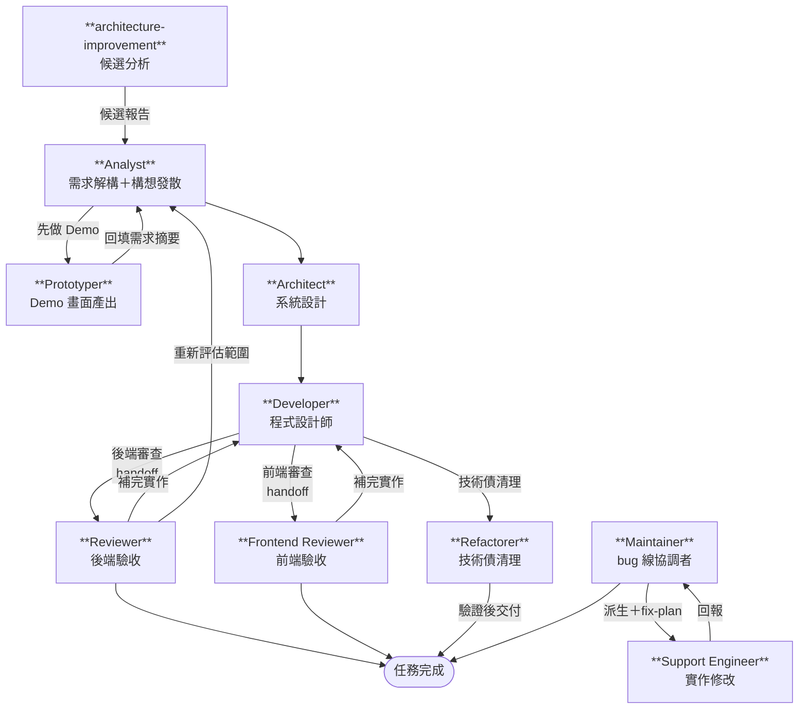

# AI 全域設定 (.ai-agents)

本目錄為個人全域 AI 輔助開發設定，適用於 Claude Code、Codex 等工具，內容充滿個人習慣與偏好，僅供參考。

**本專案必須 clone 至 `~/.ai-agents/`，setup script 與各工具連結皆依賴此路徑：**

```bash
git clone https://github.com/CloudyWing/ai-dotfiles.git ~/.ai-agents
```

## 安裝

在新的 Windows 電腦依下表由上而下進行。

| 步驟 | 內容 | 系統管理員 | 手動 |
| --- | --- | --- | --- |
| 1 | 安裝 git：`winget install Git.Git` | 否 | 否 |
| 2 | 安裝 PowerShell 7：`winget install Microsoft.PowerShell`。之後的命令都在 pwsh 執行 | 否 | 否 |
| 3 | 把本 repo clone 到 `~/.ai-agents`，命令見本文開頭 | 否 | 否 |
| 4 | 安裝 Claude Code CLI：`winget install Anthropic.ClaudeCode`。安裝後執行 `claude`，依畫面指示登入 | 否 | 登入帳號 |
| 5 | 執行 Setup，見「執行 Setup」 | 是 | 否 |
| 6 | 確認結果，見「檢查安裝結果」 | 否 | 否 |
| 7 | 選用：安裝並登記 MCP 伺服器，見「MCP 伺服器的安裝與登記」 | 啟用 WSL 時需要 | 依各項目的說明手動安裝 |
| 8 | 選用：準備 Codex 派工環境，見「Codex 派工環境」 | 建立派工帳號與啟用長路徑時需要 | 登入帳號 |

### 執行 Setup

以系統管理員身分開啟 pwsh 執行。加上 `-WhatIf` 可預覽，不寫入任何東西。

```powershell
~\.ai-agents\scripts\Setup-AIGlobalConfig.ps1
```

Setup 完成下列項目，重跑只補缺少的部分。

- 建立各工具指向本 repo 的 Symbolic Link，位置見「設定放在哪裡」。
- 安裝並啟用本 repo 的 plugin（hook 與狀態看板）與必裝的官方外掛 `microsoft-docs`。
- 把 `templates/claude-settings.shared.json` 的共用項目加進 `~/.claude/settings.json`。只新增缺少的項目，不覆寫既有值，寫入前備份原檔。授權（`permissions`）與個人偏好不在範本內，由你自行設定。
- 設定本 repo 的 Git Hook 與機器層 Git 排除清單。
- 替已登記的 Codex 派工帳號建立檔位設定檔的連結。

常見狀況如下。

- 以 Windows PowerShell 5.1 或非系統管理員身分執行時，Setup 印出指引後直接結束。
- 安裝官方外掛出現 `Filename too long` 時，執行 `git config --global core.longpaths true` 後重跑 Setup。
- 連結已存在但指向其他位置（例如 repo 搬移後）時，Setup 印出警告並略過，確認後加 `-Force` 重跑。

### 檢查安裝結果

`-Check` 只讀取現況，不做任何改動，不需要系統管理員身分。全部符合時結束碼為 0，否則為 1。加上 `-AsJson` 改輸出 JSON。

```powershell
~\.ai-agents\scripts\Setup-AIGlobalConfig.ps1 -Check
```

檢查範圍是前置軟體（pwsh 7、git、Claude Code CLI）、各工具的連結、plugin 與必裝的官方外掛、`settings.json` 的共用項目、Git Hook 設定與派工帳號的檔位設定檔連結。MCP 登記與 WSL 由 `Register-McpServer.ps1 -Check` 檢查。Claude Code 的登入狀態與 Codex CLI 不在檢查範圍。

### 選裝的官方外掛

`github` 與 `context7` 不由 Setup 安裝，需要時自行執行。

```powershell
claude plugin install github@claude-plugins-official --scope user
claude plugin install context7@claude-plugins-official --scope user
```

- `github` 需要 GitHub 個人存取權杖。啟動 Claude Code 前把它設定到環境變數 `GITHUB_PERSONAL_ACCESS_TOKEN`。
- `context7` 匿名即可使用。要使用自己的方案時，啟動 Claude Code 前設定環境變數 `CONTEXT7_API_KEY`。

權杖與金鑰的值由你自行保管，不寫進任何進版控的檔案。

### MCP 伺服器的安裝與登記

mcp-lab、infra-lab 與 FlaUI.Mcp 都是選用項目。先依下方說明手動安裝，再執行 `Register-McpServer.ps1` 登記。腳本只寫設定，不下載、不安裝、不啟動服務，不需要系統管理員身分。

```powershell
~\.ai-agents\scripts\Register-McpServer.ps1 -McpLab
~\.ai-agents\scripts\Register-McpServer.ps1 -InfraLab -InfraLabDistro <發行版名稱> -InfraLabWslRepo <WSL 內 infra-lab 的路徑>
~\.ai-agents\scripts\Register-McpServer.ps1 -FlaUI
```

- 可以在同一個命令指定多項。沒有指定任何項目時只印出用法。
- `-McpLab` 與 `-InfraLab` 登記到 Claude Code 使用者層。已存在的登記不會被覆寫，內容與範本不同時只回報。要改用範本時，先執行 `claude mcp remove <名稱> --scope user` 再重新執行腳本。新登記的 MCP 在重新啟動 Claude Code 的 Session 後載入。
- `-FlaUI` 把執行檔路徑寫入 Codex 桌面版設定檔與每個已登記派工帳號的設定檔，寫入前備份。預設路徑為 `%LOCALAPPDATA%\Programs\FlaUI-MCP\FlaUI.Mcp.exe`，用 `-FlaUIPath` 指定其他路徑。
- 加上 `-WhatIf` 預覽，不寫入任何東西。
- 加上 `-Check` 唯讀檢查，沒有指定項目時檢查三項全部。缺少任一項或派工帳號與桌面版的路徑不一致時結束碼為 1。

**mcp-lab。** 來源為 [mcp-lab](https://github.com/CloudyWing/mcp-lab)，以 Docker Compose 執行 11 個 MCP 服務，安裝在 WSL。

1. 在系統管理員 pwsh 執行 `wsl --install` 啟用 WSL，重新開機後建立 Linux 使用者，詳見 [Microsoft 的 WSL 安裝說明](https://learn.microsoft.com/windows/wsl/install)。
2. 依 mcp-lab 的 README 安裝 Docker 並啟動服務。
3. 執行 `Register-McpServer.ps1 -McpLab`。登記不需要服務已在執行。

**infra-lab。** 來源為 [infra-lab](https://github.com/CloudyWing/infra-lab)，以 Taskfile 驅動本機 Docker 服務，安裝在 WSL，前置需求同 mcp-lab。

1. 依 infra-lab 的 README 安裝，新電腦以 `task bootstrap` 初始化。
2. 在 WSL 內執行 `task mcp:config`，它會印出形如 `claude mcp add infra-lab --scope user -- wsl.exe -d <發行版名稱> -e bash <WSL 內 repo 路徑>/scripts/mcp.sh` 的命令，從中取得發行版名稱與 WSL 內 repo 路徑。
3. 執行 `Register-McpServer.ps1 -InfraLab` 並帶入這兩個值。這兩個值只在首次登記時需要。

**FlaUI.Mcp。** 來源為 [FlaUI-MCP](https://github.com/starpia-forge/FlaUI-MCP) 的 Releases，每一版有四個壓縮檔。

| 檔案 | 平台 | .NET 需求 |
| --- | --- | --- |
| `FlaUI-MCP-win-x64-<版本>-self-contained.zip` | x64 | 不需要 |
| `FlaUI-MCP-win-x64-<版本>-framework-dependent.zip` | x64 | .NET 8 Runtime |
| `FlaUI-MCP-win-arm64-<版本>-self-contained.zip` | arm64 | 不需要 |
| `FlaUI-MCP-win-arm64-<版本>-framework-dependent.zip` | arm64 | .NET 8 Runtime |

1. 確認已安裝 Codex 桌面版，且 `~/.codex/config.toml` 已存在。`-FlaUI` 不會建立這個檔。
2. 下載符合平台的壓縮檔，解壓到 `%LOCALAPPDATA%\Programs\FlaUI-MCP`。路徑不帶版號，升級時設定不必改。
3. 執行 `Register-McpServer.ps1 -FlaUI`。
4. 之後每次新建派工帳號，或 FlaUI.Mcp 換了位置（以 `-FlaUIPath` 指定新路徑），都重新執行一次，桌面版與各派工帳號會一併更新。

### Codex 派工環境

需要讓 Claude 把審查、測試取證等工作交給 Codex 時才需要這一步。

**Codex CLI。**

- 先安裝 Node.js（`winget install OpenJS.NodeJS.LTS`），再以 `npm i -g @openai/codex` 安裝，更新使用 `codex update`。桌面版隨附的 `bin\codex.exe` 不會隨桌面版更新，不能用於派工。
- 安裝或更換機器後執行 `codex --version` 與 `codex doctor`，確認 PATH 上的 `codex` 可用。
- 派工需要 Codex 的 MXC 沙盒與 PowerShell 7。

**派工帳號。** 派工使用專用的 Codex 帳號目錄，與 Codex 桌面版的 `~/.codex` 分開，派工不會切換桌面版的登入。桌面版與派工帳號若登入同一個 ChatGPT 帳號，兩邊共用額度。

```powershell
~\.ai-agents\scripts\New-CodexDispatchAccount.ps1 -Name account-a
```

- 腳本建立 `~/.codex-<名稱>` 目錄、最小的 `config.toml` 與檔位設定檔的連結，並登記到 `~/.ai-agents/.local/machine.json`。重跑只補缺少的部分，加上 `-WhatIf` 可預覽。
- 建立連結的權限不足時，改以具備建立 Symbolic Link 權限的 pwsh（例如系統管理員身分）重新執行。
- 有使用 FlaUI.Mcp 時，建立帳號後再執行一次 `Register-McpServer.ps1 -FlaUI`，新帳號才會取得它的設定。
- 腳本不執行登入，最後會印出已帶 `CODEX_HOME` 的登入命令，由你自行執行。
- `-ProjectPath <專案路徑>` 可預先把專案加入該帳號的信任清單。
- 帳號閒置過久時登入會失效。派工回報 401 時，結果會附上該帳號的重新登入命令。

**檔位設定。** 派工的 model 與推理強度依檔位決定，檔位清單與設定寫在 `scripts/dispatch/executor-registry.json`。

- 查詢現行檔位：`pwsh -NoProfile -File scripts\Select-DispatchExecutor.ps1 -Describe`。
- 要改設定只改登錄表。各帳號目錄的檔位設定檔是指向 repo 產生檔的連結，不能單機覆寫。派工前發現不一致時會停止並列出修正命令。
- 帳號選擇與換帳號的規則見 `skills/codex-dispatch/references/run.md`「帳號」。

**Windows 長路徑。** 線工作樹內的 NuGet 套件路徑可能超過 260 字元。Setup 會檢查是否已啟用，以系統管理員身分執行下列命令可啟用，設定後需重新登入或重開機。

```powershell
~\.ai-agents\scripts\Setup-AIGlobalConfig.ps1 -EnableLongPaths
```

---

## 核心概念

| 概念 | 定位 | 何時生效 | 用途 |
| --- | --- | --- | --- |
| **Rule** | 規範文件 | 始終生效（自動注入每次對話） | 強制編碼規範、風格約束，AI 無法繞過 |
| **Skill** | 專門能力模組 | 知識型：AI 自動載入；指令型：使用者以 `/` 呼叫 | 封裝知識規範、可執行任務，支援腳本與資源 |
| **Agent** | 獨立代理人設定 | 依設定檔觸發或手動指定 | 定義 AI 角色、行為框架與可用工具 |

### 平台分工

| 工作 | 執行端 |
| --- | --- |
| 需求釐清、設計、實作、bug 診斷與修正 | Claude（Persona，或由主 Agent 派生的 subagent） |
| 審查 | Codex；Codex 不可用時由 Claude subagent 承接 |
| 測試取證、事實校閱、顧問、影像產生 | Codex |

功能線在 Claude Code 與 Analyst 討論需求即可，後續的設計、實作與審查由主 Agent 發動，不需手動切換平台。執行者由 `scripts/dispatch/executor-registry.json` 決定，規則見 `rules/claude/30-dispatch.md`。

---

## 本機檔案慣例

`.local/` 與 `.local.` 後綴表示「本機私有、不進版控」，前者收納 AI 工作產物，後者保存本機覆寫設定。兩者由 Setup 設定的機器層 Git 排除清單排除，不需寫進專案的 `.gitignore`。

| 檔案 | 用途 | 說明 |
| --- | --- | --- |
| `AGENTS.md` | 專案共享規範 | 專案層規則與 `AI-DECLARATIONS` 宣告，依專案版控策略管理 |
| `AGENTS.local.md` | 個人對此專案的偏好覆寫 | 僅影響目前專案，不取代專案共享規範 |
| `CONTEXT.local.md` | Session 上下文交接 | 可選的本機交接檔；僅記錄跨 session 仍有效的環境前置作業、本機限制與已知陷阱 |
| `GLOSSARY.md` | 專案專屬業務術語 | 由 `glossary` skill 依使用者確認維護 |
| `docs/adr/` | Architecture Decision Record | 依 `adr` skill 的決策門檻，經使用者同意後追加 |

`.local/` 目錄結構如下：

```text
.local/
├── ai-context/                         # AI 脈絡索引產物
└── ai-sessions/
    ├── handoff/
    ├── report/
    ├── history/
    ├── scratch/
    ├── backups/
    ├── inputs/
    ├── screenshots/
    ├── style-baselines/
    ├── test-context/                   # 測試環境資料檔 test-context.md（保留，不進版控）
    └── ui-demo/
```

各目錄的用途見 `session-artifacts` skill。`~/.ai-agents/.local/machine.json` 記錄派工帳號清單等只屬於這台電腦的資訊。

---

## 設定放在哪裡

本專案使用 **Symbolic Link (符號連結)** 讓各工具共用同一份設定，建立時需要系統管理員權限。

| 特性 | Shortcut (捷徑) | Hard Link (實體連結) | Junction Point (連接點) | Symbolic Link (符號連結) |
| --- | --- | --- | --- | --- |
| 支援對象 | 檔案與資料夾 | **僅限檔案** | **僅限資料夾** | 檔案與資料夾 |
| 跨磁碟機 | 支援 | ❌ | 支援 | 支援 |
| 對程式透明 | ❌ 視為獨立檔案 | ✅ | ✅ | ✅ |
| 刪除本尊後 | 捷徑失效 | **內容還在** | 連結失效 | 連結失效 |

### Claude Code — `~/.claude/`

| 路徑 | 用途 |
| --- | --- |
| `CLAUDE.md` | 全域記憶與指令（Claude Code 會自動讀取），連結到 `instructions.md` |
| `rules/*.md` | 只在 Claude 端載入的常駐規則，連結到 `rules/claude/`。連結缺失時 Claude Code 不會提示，Persona、授權與派工規則會整組失效，重跑 Setup 即可恢復 |
| `skills/<name>/SKILL.md` | Skills（知識型自動載入；指令型以 `/skill-name` 呼叫） |
| `agents/*.md` | 全域自訂 Persona 與 Claude 端 sub-agent |
| `settings.json` | 使用者設定。Setup 只新增 `templates/claude-settings.shared.json` 內缺少的共用項目，你已設定的值（含設為 `false` 的外掛）一律保留 |

### Codex — `~/.codex/`（或 `$CODEX_HOME`）

| 路徑 | 用途 |
| --- | --- |
| `AGENTS.md` | 全域指令檔（Codex 會載入） |
| `AGENTS.override.md` | 全域覆蓋檔（若存在且非空會優先套用） |
| `agents/<name>.toml` | 自訂 Agent（執行型，以 `/agent <name>` 切換） |
| `~/.agents/skills/<name>/SKILL.md` | 使用者技能（Codex 會掃描） |

### Claude Code Hook

hook 由 plugin `ai-agents-hooks@ai-agents-local` 提供，原始碼位於 `claude-plugins/`，由 Setup 安裝並啟用。修改 hook 後，新 session 不需重新安裝即可採用新內容。

| Hook | 用途 |
| --- | --- |
| `post-edit-write` | 寫入檔案後檢查 BOM 規範，並記錄 `.md` 的格式檢查提示 |
| `doc-path` | 進版控的 `.md` 含本機磁碟機絕對路徑時提醒改用佔位符或相對路徑，不阻擋寫入 |
| `host-guard` | 拒絕直接呼叫 `powershell.exe` 的命令並提示改用 pwsh。其他專案明確需要 5.1 時，在 Claude Code 設定的 `env` 加入 `AI_AGENTS_ALLOW_POWERSHELL51=1` |

### 狀態看板

plugin `line-status-board@ai-agents-local` 在 Claude Desktop 側邊 Pane 顯示「工作總覽」，包含 Session、派工、Codex 額度、工作線與工作目錄，每 60 秒更新一次，不耗用模型 token。Setup 會安裝並啟用它，各區塊的行為與設定項見 [claude-plugins/line-status-board/README.md](./claude-plugins/line-status-board/README.md)。

---

## 目錄結構

```plaintext
~/.ai-agents/
├── instructions.md                     # 核心開發規範（主 Rule，Claude 與 Codex 共用）
├── rules/
│   └── claude/                         # 只在 Claude 端載入的常駐規則
├── agents/
│   ├── claude/                         # Persona 與 sub-agent 規則檔（.md）
│   └── codex/                          # 審查類 Agent 規則檔（.toml）
├── skills/                             # 技能模組（Skill）
├── templates/                          # 專案初始化、Demo 外框、派工與 Claude 設定的範本
├── scripts/                            # 安裝、派工、查詢與索引腳本
├── claude-plugins/                     # 本機 marketplace、hook 與狀態看板 plugin
├── docs/                               # Agent／Skill 索引（生成檔）與 ADR（adr/）
├── .githooks/                          # Git 原生 Hook
├── AGENTS.md                           # 維護本 repo 的專案層規則
├── README.md                           # 本文件
├── LICENSE.md                          # 授權條款
├── git-global-excludes                 # 機器層 Git 排除清單
├── .editorconfig                       # 編輯器格式設定（最高優先）
├── .gitattributes                      # 行尾格式與二進位標記
└── .gitignore                          # 版控排除清單
```

---

## 腳本一覽

`scripts/` 根目錄只放可直接執行的 Verb-Noun `.ps1` 與 `.csx`，內部模組、產生檔與測試放在子目錄（`lib/`、`dispatch/`、`codex-run/`、`codex-profiles/`、`tests/`）。`.ps1` 以 pwsh 7 執行。

**安裝與設定**

| 腳本 | 用途 |
| --- | --- |
| `Setup-AIGlobalConfig.ps1` | 建立各工具的連結、安裝 plugin、套用 `settings.json` 共用範本、設定 Git Hook；`-Check` 唯讀檢查 |
| `Register-McpServer.ps1` | 登記 mcp-lab、infra-lab 與 FlaUI.Mcp；`-Check` 唯讀檢查 |
| `New-CodexDispatchAccount.ps1` | 建立並登記 Codex 派工帳號 |

**派工**

| 腳本 | 用途 |
| --- | --- |
| `Select-DispatchExecutor.ps1` | 依任務標註與登錄表選出派工執行者 |
| `Invoke-CodexRun.ps1` | 依一份派遣檔執行一次 Codex 派工 |
| `Test-CodexReviewReport.ps1` | 檢查審查報告的格式 |
| `Write-ClaudeRunRecord.ps1` | 為 Claude 審查者寫出執行紀錄 |
| `Update-ExecutorIncomplete.ps1` | 保存各執行者的未完成次數 |
| `Get-CodexQuota.ps1` | 查詢 Codex 額度，只供顯示與紀錄 |

派工腳本由 Agent 呼叫，用法見 `codex-dispatch` 與 `executor-selection` skill。

**狀態與成本**

| 腳本 | 用途 |
| --- | --- |
| `Get-LineStatus.ps1` | 彙整工作線、Git 狀態、額度與派工紀錄，供狀態看板使用 |
| `Get-LineCost.ps1` | 彙整一條線的派工成本 |
| `Get-ClaudeSessionUsage.ps1` | 彙總 Claude session 與子代理的用量 |
| `Invoke-WorkOverviewCleanup.ps1` | 列出可清理的工作樹、分支與備份，確認後才刪除 |

**專案脈絡**

| 腳本 | 用途 |
| --- | --- |
| `Ensure-AiContextArtifacts.ps1` | 視需要重新產生 `.local/ai-context/` 的索引產物 |
| `Export-ApiSurface.csx`、`Export-TypeHierarchy.csx`、`Export-ProjectGraph.csx` | 由上一支腳本呼叫，輸出各類索引 |
| `Export-CommentVocabularyCandidates.csx` | 輸出資料庫註解語彙候選，由 `database-comment-generator` skill 使用 |

---

## 維護這個 repo

維護規則寫在 [AGENTS.md](./AGENTS.md)，這裡只列日常會遇到的三件事。

**Git Hook。** Setup 會把本 repo 的 `core.hooksPath` 設為 `.githooks`。之後每次 `git commit` 會執行下列檢查。

- 重新產生 `docs/agents.md` 與 `docs/skills.md` 並納入該次 commit。
- 檢查 staged 的 `.md`、`.toml` 新增行是否含磁碟機絕對路徑，違規時阻止 commit。
- 依登錄表重新產生 `scripts/codex-profiles/` 的檔位設定檔並納入該次 commit。

**生成檔。** `docs/agents.md`、`docs/skills.md` 與 `scripts/codex-profiles/*.config.toml` 由上述 Hook 產生，不要手動編輯。

**測試。**

- 測試位於 `scripts/tests/`，以 pwsh 逐支單獨執行，例如 `pwsh -NoProfile -File scripts\tests\Test-SetupCheck.ps1`。`Test-CodexRunAll.ps1` 一次執行派工入口的全部測試，不呼叫 Codex 服務端。
- `scripts/tests/Invoke-CodexRunLive.ps1 -Scenario review`（或 `failover`）會呼叫 Codex 服務端並消耗額度，加上 `-DryRun` 只列出將執行的內容。
- hook 的測試需要 PATH 上有 Node.js 22.18 以上。plugin 另有 TypeScript 測試，以 `claude plugin test <plugin 目錄>` 執行。

---

## Skill 與 Agent

清單見 [docs/skills.md](./docs/skills.md) 與 [docs/agents.md](./docs/agents.md)。

Skill 分為兩種類型：

- **知識型**：Claude 依上下文自動載入並套用（如編碼規範、LINQ 查詢規則）。
- **指令型**：須使用者以 `/skill-name` 明確觸發（如 `/generate-changelog-zh-tw`、`/generate-api-doc`）。

Agent 依執行方式分為兩類：

- **Persona**：以語意切換方式執行。適合需要多輪對話、強依賴上下文的需求分析、實作階段控制與文件編輯。
- **sub-agent**：由主 Agent 派生。適合有明確輸入與交接檔案的設計、審查、掃描與清理任務。

### Agent 執行流程



流程分為四條路徑。

- **功能線**：Analyst 確認需求後交 Architect 設計，實作與審查由主 Agent 派出。需要先看畫面時，先由 Prototyper 產出 Demo。
- **bug 線**：Maintainer 診斷後派生 Support Engineer 修正並驗收。
- **技術債清理**：由 Refactorer 處理，每批修改後執行測試。
- **架構改善**：`architecture-improvement` skill 由人員觸發，先產出候選報告，確認範圍後才進入設計。

---

## License

This project is licensed under the [MIT License](./LICENSE.md).
