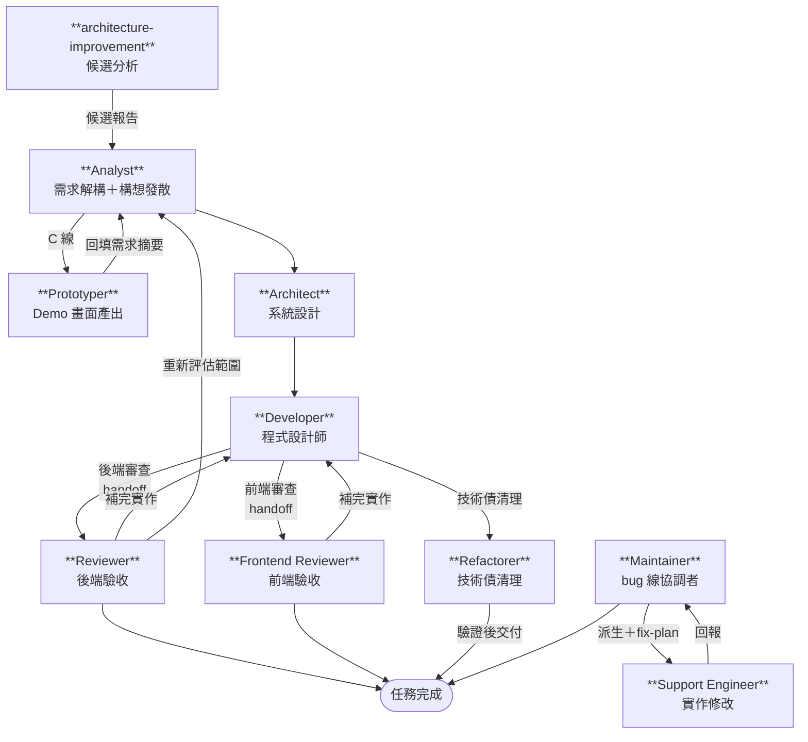

# AI 全域設定 (.ai-agents)

本目錄為個人全域 AI 輔助開發設定，適用於 Claude Code、Codex 等工具，內容充滿個人習慣與偏好，僅供參考。

**本專案必須 clone 至 `~/.ai-agents/`，setup script 與各工具連結皆依賴此路徑：**

```bash
git clone https://github.com/CloudyWing/ai-dotfiles.git ~/.ai-agents
```

## 安裝

1. 以系統管理員身分開啟 PowerShell，執行 Setup。腳本不是以系統管理員身分執行時會直接結束；加上 `-WhatIf` 可預覽。

   ```powershell
   ~\.ai-agents\scripts\Setup-AIGlobalConfig.ps1
   ```

2. Setup 依序完成下列項目，重跑只補缺少的部分。
   - 建立各工具指向本 repo 的 Symbolic Link，對應位置見 §3。
   - 註冊本機 marketplace `ai-agents-local`，安裝並啟用其中的 plugin（hook 與狀態看板）。
   - 設定本 repo 的 `core.hooksPath` 與機器層 Git 排除清單。
   - 檢查 Windows 長路徑與 Codex CLI；Codex 檔位設定檔缺少時依初始值建立，其餘缺件印出修復指引。
3. 需要跨平台派工時，依 §3「Codex CLI 前置需求」安裝 Codex CLI，並依「Codex profile 檔位設定」確認檔位設定檔。派工帳號目錄為選用，見「獨立 Codex 帳號目錄」。

---

## 1. 核心概念對照

| 概念 | 定位 | 何時生效 | 用途 |
| --- | --- | --- | --- |
| **Rule** | 規範文件 | 始終生效（自動注入每次對話） | 強制編碼規範、風格約束，AI 無法繞過 |
| **Skill** | 專門能力模組 | 知識型：AI 自動載入；指令型：使用者以 `/` 呼叫 | 封裝知識規範、可執行任務，支援腳本與資源 |
| **Agent** | 獨立代理人設定 | 依設定檔觸發或手動指定 | 定義 AI 角色、行為框架與可用工具 |

### 本專案策略

- 以 `instructions.md` 作為唯一主規則檔（Single Rule）。
- Commit 訊息生成以 `skills/generate-commit/` Skill 形式獨立管理。

### 平台分工

| 角色 | 執行端 | 觸發方式 |
| --- | --- | --- |
| Analyst、Developer、Editor、Maintainer | 依所在平台 | Persona，以語意切換 |
| Architect、Prototyper | Claude | 由主 Agent 派生 |
| Developer、Refactorer、Support Engineer | Claude subagent（Haiku 或 Sonnet，依執行者登錄表） | 由主 Agent 以 Agent 工具派生，或 Maintainer 派生 Support Engineer |
| Reviewer、Frontend Reviewer、Contract Auditor | Codex（Codex 離線時降級為 Claude Sonnet subagent） | 由主 Agent 依派遣判準以資源派遣發動 |
| 測試（煙霧驗證取證）、事實校閱、顧問、影像產生 | Codex | 由主 Agent 依執行者登錄表以資源派遣發動 |

功能線建議在 Claude Code 處理 Analyst 與 Architect，之後的 Developer 與 Reviewer 鏈由主 Agent 在背景發動，不需手動切換平台。bug 由 Maintainer 診斷，實作交由 Support Engineer 完成。

涉及畫面的需求由 Analyst 判定 UI 線別，版面複雜或需對外溝通時派生 Prototyper 產出 Demo 畫面。畫面相關工作另受 `uiux` skill 約束，該 skill 平常依觸發語自動載入；判斷本輪工作涉及畫面而它未被載入時，可直接以 `/uiux` 手動強制載入。

### 本地檔案慣例（不 commit）

`.local/` 與 `.local.` 後綴表示「本機私有、不進版控」，前者收納 AI 工作產物，後者保存本機覆寫設定：

| 檔案 | 用途 | 說明 |
| --- | --- | --- |
| `AGENTS.md` | 專案共享規範 | 專案層規則與 `AI-DECLARATIONS` 宣告，依專案版控策略管理 |
| `AGENTS.local.md` | 個人對此專案的偏好覆寫 | 僅影響目前專案，不取代專案共享規範 |
| `CONTEXT.local.md` | Session 上下文交接 | 可選的本機交接檔；僅記錄跨 session 仍有效的環境前置作業、本機限制與已知陷阱 |
| `GLOSSARY.md` | 專案專屬業務術語 | 由 `glossary` skill 依使用者確認維護 |
| `docs/adr/` | Architecture Decision Record | 由 `adr` skill 依決策門檻追加 |

`.local/` 與 `*.local.md` 由 Setup 設定的機器層 Git 排除清單排除，不需寫進專案的 `.gitignore`。

`.local/` 目錄結構如下：

```text
.local/
├── ai-context/                         # AI 脈絡索引產物
└── ai-sessions/
    ├── handoff/
    ├── report/
    ├── history/
    ├── scratch/
    ├── backups/
    ├── inputs/
    ├── screenshots/
    ├── style-baselines/
    └── ui-demo/
```

交接檔與報告綁定在本輪任務的 `work-root`，判定方式見 `instructions.md` §1.5「work-root 判定」。

#### 本機設定 machine.json

`~/.ai-agents/.local/machine.json` 是本機設定，不進版控，記錄值班 Session、派工帳號清單等只屬於這台電腦的資訊。

協調 Session 不需要登記。Agent 把啟動它的那個 Session 當作協調 Session，接受它轉述的使用者決定；你手動開的 Session 則要你直接在該 Session 回覆。轉述的判定規則見 `instructions.md` §1.5「授權期限」。

---

## 2. Windows 連結類型對照表

本專案使用 **Symbolic Link (符號連結)** 來實現跨工具共用設定檔。

| 特性 | Shortcut (捷徑) | Hard Link (實體連結) | Junction Point (連接點) | Symbolic Link (符號連結) |
| --- | --- | --- | --- | --- |
| 支援對象 | 檔案與資料夾 | **僅限檔案** | **僅限資料夾** | 檔案與資料夾 |
| 跨磁碟機 | 支援 | ❌ | 支援 | 支援 |
| 對程式透明 | ❌ 視為獨立檔案 | ✅ | ✅ | ✅ |
| 刪除本尊後 | 捷徑失效 | **內容還在** | 連結失效 | 連結失效 |

> **建立時需要系統管理員權限建立 Symbolic Link。**

---

## 3. 各家 AI 工具全域設定位置

### Claude Code — `~/.claude/`

| 路徑 | 用途 |
| --- | --- |
| `CLAUDE.md` | 全域記憶與指令（Claude Code 會自動讀取） |
| `skills/<name>/SKILL.md` | Skills（知識型自動載入；指令型以 `/skill-name` 呼叫） |
| `agents/*.md` | 全域自訂 Persona 與 Claude 端 sub-agent |
| `settings.json` | 工具權限與其他使用者設定 |

#### Claude Code Hook 設定

本專案的 hook 由本機 marketplace `ai-agents-local` 的 plugin `ai-agents-hooks@ai-agents-local` 提供，原始碼位於 `claude-plugins/`，由 Setup 的 8b 註冊並啟用。修改 plugin 內的 hook 腳本後，新 session 不需重新安裝即可採用新內容。

| Hook 腳本 | 觸發條件 | 用途 |
| --- | --- | --- |
| `post-edit-write-hook.ps1` | Edit 或 Write 工具寫入檔案後 | 提示執行 check-markdown skill（`.md`）；驗證 BOM 規範（`.ps1`/`.csv` 需有 BOM，`.md`/`.json` 等不可有 BOM） |
| `turn-guard-hook.ps1` | `UserPromptSubmit`、`PostToolUse`、`PostToolUseFailure`、`Stop` | 將每個 turn 的工具使用與失敗紀錄寫入 `${CLAUDE_PLUGIN_DATA}\turn-guard\<session_id>.jsonl`；同一失敗在同一 turn、同一 agent 內第 2 次發生時，以 `additionalContext` 提醒該 agent 一次，要求先說明下次為何會成功，說不出來就停下回報；不阻擋工具執行 |

#### 狀態看板 plugin

`line-status-board@ai-agents-local` 在 Claude Desktop 側邊 Pane 顯示「工作總覽」，依序為 Session、Codex 額度、工作線與工作目錄四個區塊。資料來自 `scripts/Get-LineStatus.ps1 -AsJson` 與 `ccd_session_mgmt.list_sessions`，每 60 秒更新一次，也可按「重新整理」，更新過程不耗用模型 token。掃描範圍為預設清單加上目前 Session 所在的 repo。

- 點 Session 列會開啟該 Session。
- Codex 額度列在帳號登入失效時顯示「登入失效」與該帳號的重新登入命令，達到用量上限時顯示「已達上限」。登入由使用者自行執行。沒有週視窗的帳號，額度列的週額度位置顯示「無週視窗」。
- 狀態列顯示一行摘要，內容為執行中 Session 數與額度最低帳號的剩餘量。
- Session 由執行中轉為閒置時跳一次提醒；看板載入後取得的第一次狀態只作為比較基準。
- 全部帳號的額度剩餘量都低於 20% 時跳一次提醒，提醒文字依各帳號的額度視窗長度標示（例如 5 小時、30 天）。同一視窗只提醒一次，視窗重設後才再提醒。已達上限與登入失效的帳號視同低於門檻；有帳號查詢失敗時不提醒。
- 清理按鈕呼叫 `scripts/Invoke-WorkOverviewCleanup.ps1`，先列出可清理項目、大小與不能清的原因，按確認後才刪除。看板對工作區檔案的寫入只有清理；提醒狀態存在 plugin 的 store，複製按鈕寫入剪貼簿。

Setup 的 8b 會安裝並啟用此 plugin，Desktop 開新 Session 時自動開啟 Pane。不執行 Setup 時，可手動安裝：

```powershell
claude plugin marketplace add ~/.ai-agents/claude-plugins
claude plugin install line-status-board@ai-agents-local --scope user
```

`workRoots` 可設定以分號分隔的掃描位置，空白時使用腳本預設值；`scriptPath` 可指定腳本路徑，空白時自動尋找；`notifySessionDone` 控制 Session 跑完提醒，預設開啟。修改設定後執行 `/reload-plugins`。plugin 需搭配同一 repo 的新版腳本。

### Codex — `~/.codex/`（或 `$CODEX_HOME`）

| 檔案 | 用途 |
| --- | --- |
| `AGENTS.md` | 全域指令檔（Codex 會載入） |
| `AGENTS.override.md` | 全域覆蓋檔（若存在且非空會優先套用） |

| 路徑 | 用途 |
| --- | --- |
| `agents/<name>.toml` | 自訂 Agent（執行型，以 `/agent <name>` 切換） |
| `~/.agents/skills/<name>/SKILL.md` | 使用者技能（Codex 會掃描） |

#### Codex CLI 前置需求

- 使用 `npm i -g @openai/codex` 安裝 Codex CLI，更新使用 `codex update`。
- 跨平台派工需要在 PATH 上找到 `codex`。桌面版隨附的 `bin\codex.exe` 版本固定在安裝當下，不會隨桌面版更新，不能用於派工。
- 安裝或更換環境時執行 `codex --version` 確認 CLI 可用；更換機器後先執行 `codex doctor`，確認執行檔、PATH 與本機設定可用。
- 派工的啟動端需要 PowerShell 7+。
- 派工需要隔離 worktree 時，來源目錄必須是 Git repo；腳本不會自動 `git init`。

#### Windows 長路徑

派工 worktree 內的 NuGet 套件路徑可能超過 260 字元。執行 `Setup-AIGlobalConfig.ps1` 時會檢查 Windows 的 `LongPathsEnabled`，也可在 PowerShell 中查詢：

```powershell
Get-ItemProperty -Path 'HKLM:\SYSTEM\CurrentControlSet\Control\FileSystem' -Name LongPathsEnabled
```

以系統管理員身分執行下列命令可啟用長路徑；加上 `-WhatIf` 可預覽設定。設定後需重新登入或重開機才生效。

```powershell
.\scripts\Setup-AIGlobalConfig.ps1 -EnableLongPaths
```

#### Codex profile 檔位設定

1. 派工使用 `review`、`deep-review`、`scan`、`advisor` 四個檔位，以 `--profile <檔位>` 讀取選定 Codex home 內的 `<CodexHome>/<檔位>.config.toml`。未指定 home 時，`machine.json` 登記清單非空則由腳本依登記順序選第一個可用帳號（已登入、檔位設定檔齊備、專案信任可用，且未被記為不支援該檔位 model），清單為空才預設 `~/.codex`。Request 必須指定 `profile`；指定 `default`、缺少 `profile` 或設定檔不存在時在啟動前拒絕。執行者與檔位的對應由 `scripts/dispatch/executor-registry.json` 決定，規則見 `instructions.md` §1.5 與 `executor-selection` skill。
2. 設定檔內容為各檔位要使用或覆寫的 Codex 設定，常用鍵如下。Setup 提供初始值，檔案建立後屬本機設定。

   ```toml
   model = "<model-id>"
   model_reasoning_effort = "<effort>"

   [agents]
   default_subagent_model = "<較低成本的 model-id>"
   default_subagent_reasoning_effort = "<effort>"
   ```

3. 每個檔位的設定寫在各自的 `<檔位>.config.toml`。執行時先載入 Codex home 的 `config.toml`，再疊加所選檔位的設定。`config.toml` 內的 `[profiles.*]` 屬 legacy 格式。
4. 檔位檔屬本機設定，不進版控。Setup 在 `~/.codex` 缺少四個檔位的設定檔時建立，不覆寫既有檔；另檢查各派工帳號的檔位連結，殘留的 `default.config.toml` 只警示不刪除。

#### 獨立 Codex 帳號目錄

派工可使用專用的 Codex 帳號目錄，與 Codex Desktop 使用的預設目錄 `~/.codex` 分開。派工只在單次子行程指定 `CODEX_HOME`，不會更換、改寫 Desktop 或預設目錄的登入，因此 Desktop 使用中不會被派工切換帳號。建議的配置是 `~/.codex` 留給 Desktop 且不登記，派工用的每個帳號各用一個專用目錄。Desktop 與某個派工帳號若登入同一個 ChatGPT 帳號，兩邊仍共用該帳號的額度。

派工帳號以 `scripts\New-CodexDispatchAccount.ps1` 建立。腳本建立 `~/.codex-<名稱>` 目錄與最小 `config.toml`，以連結共用 `~/.codex` 的檔位設定檔，並登記到 `~/.ai-agents/.local/machine.json`。

```powershell
.\scripts\New-CodexDispatchAccount.ps1 -Name account-a
```

在 PowerShell 提示字元直接執行。派工時會自動把派遣的專案加入該帳號的信任清單，建立帳號時不必列出專案。`-ProjectPath` 為選填，用於預先信任專案，例如 `-ProjectPath 'C:\Users\<使用者>\.ai-agents'`。

帳號已存在時重跑只補缺少的部分，不覆寫既有設定；之後新增專案不需要重跑。設定不符時，腳本列出問題與修法，不留下做一半的狀態。加上 `-WhatIf` 可預覽而不寫入。建立 Symbolic Link 權限不足時，改以具備建立 Symbolic Link 權限的 PowerShell 重新執行。

`config.toml` 的最小內容為 `[windows]` 段。`[projects.'<小寫的專案絕對路徑>']` 由派工時自動補上，或由 `-ProjectPath` 預先加入。下例為補上一個專案信任後的內容。

```toml
[windows]
sandbox = "mxc"

[projects.'c:\users\<使用者>\.ai-agents']
trust_level = "trusted"
```

`[windows]` 段的 `sandbox` 接受 `"mxc"` 與 `"elevated"`，缺少 `[windows]` 段時補上 `"mxc"`。Windows 上新啟動的派工一律以 MXC 執行，由派工腳本指定，不依賴此設定值。

缺少 `config.toml` 的登記帳號在自動選帳號時被略過（原因碼 `TrustConfigMissing`），由建立腳本補齊。

`config.toml` 設定異常的帳號會被略過，全部帳號都不可用時拒絕派工並說明原因。帳號回報檔位 model 不支援（停用訂閱的帳號也以此呈現）時，派工腳本把該帳號與 model 記在 `.local\codex-account-health.json`，24 小時內派工會略過該帳號；所有帳號都被記錄時仍實際嘗試一次。

腳本不執行登入，最後輸出已設定 `CODEX_HOME` 的登入命令，由使用者自行執行。

```powershell
powershell.exe -NoProfile -Command '$env:CODEX_HOME = ''C:\Users\<使用者>\.codex-account-a''; codex login'
```

帳號閒置過久時 token 會失效，`Get-CodexQuota.ps1` 或派工會回報 401。派工回報 401，或帳號因登入檔缺少、為空而被略過時，派遣結果會附上該帳號、格式與上例相同的登入命令，執行該命令重新登入。

---

## 4. 目錄結構總覽

```plaintext
~/.ai-agents/
├── .gitignore                          # 版控排除清單
├── .gitattributes                      # 行尾格式與二進位標記
├── README.md                           # 本文件
├── instructions.md                     # 核心開發規範（主 Rule）
├── docs/                               # 詳細索引與補充說明文件
├── git-global-excludes                 # 機器層 Git 排除清單
├── agents/
│   ├── claude/                         # Persona 與 sub-agent 規則檔（.md 格式）
│   └── codex/                          # Persona 與執行型 Agent 規則檔（.toml 格式，Claude subagent 承接時同樣讀取）
├── claude-plugins/                     # 本機 marketplace、hook 與狀態看板 plugin
├── skills/                             # 技能模組（Skill）
├── templates/                          # 新專案初始化範本、Demo 外框範本與派工範本
└── scripts/                            # 安裝、檢查與 hooks 腳本
```

---

## 5. Scripts 與命名慣例

- `scripts/` 根目錄只放使用者可直接執行的 Verb-Noun `.ps1` 與既有 `.csx` 腳本。
- `scripts/Get-DispatchProgress.ps1` 唯讀查詢派遣進度，可依 `LineSlug` 或 `DispatchSlug` 篩選；預設顯示未結束與最近 24 小時內結束的項目。
- `scripts/Get-LineStatus.ps1` 唯讀彙整線狀態、Git 狀態與額度。
- `scripts/Select-DispatchExecutor.ps1` 依任務標註與 `scripts/dispatch/executor-registry.json` 選出派工執行者並輸出 `[派工判定]` 行，唯讀、不呼叫網路。
- `scripts/Get-CodexQuota.ps1` 查詢 Codex 額度，只供顯示與紀錄。
- `scripts/Invoke-WorkOverviewCleanup.ps1` 列出可清理的 worktree、分支與線層歷史備份，必須指定 `-Root`；預設只列出，以 `-ConfirmPlan` 帶入列出時的 planId 才刪除。
- `scripts/Get-ClaudeSessionUsage.ps1` 唯讀彙總主 session 與子代理 transcript 用量，依 `message.id` 去重，分別輸出主 session、子代理與總計三組。
- 內部責任檔、loader 與測試輔助放在子目錄，例如 `scripts/dispatch/` 與 `scripts/tests/`；派工測試入口位於 `scripts/tests/Test-DispatchRecoveryBinding.ps1`。
- `claude-plugins/` 內由工具自動呼叫的 hook 腳本，使用全小寫 kebab-case 命名。
- `.githooks/` 內為 Git 原生 Hook，由 `Setup-AIGlobalConfig.ps1` 透過 `core.hooksPath` 啟用。

### Git Hook 設定

執行 `Setup-AIGlobalConfig.ps1` 時會自動完成以下設定：

```powershell
git config core.hooksPath .githooks
```

啟用後，每次 `git commit` 會自動執行 `.githooks/Update-Docs.ps1`，重新產生 `docs/agents.md` 與 `docs/skills.md` 並納入本次 commit。這兩個檔案為生成檔，請勿手動編輯；frontmatter 不一致時，腳本以非零結束碼阻止 commit。

---

## 6. 內建 Skill 清單

詳見 [docs/skills.md](./docs/skills.md)。

Skill 分為兩種類型：

- **知識型**：Claude 依上下文自動載入並套用（如編碼規範、LINQ 查詢規則）。
- **指令型**：須使用者以 `/skill-name` 明確觸發（如 `/generate-changelog-zh-tw`、`/generate-unit-test`）。

---

## 7. 內建 Agent 清單

詳見 [docs/agents.md](./docs/agents.md)。

Agent 依執行平台分為兩類：

- **Persona**：以語意切換方式執行。適合需要多輪對話、強依賴上下文的需求分析、實作階段控制與文件編輯。
- **sub-agent**：由主 Agent 派生。適合有明確輸入與交接檔案的設計、審查、掃描與清理任務。

### Agent 執行流程



> 功能線：Analyst 收斂需求後由 Architect 設計，設計驗收通過後由主 Agent 依執行者登錄表派生 Claude subagent 進入實作，再以資源派遣發動 Codex 審查（Codex 離線時降級為 Claude Sonnet subagent）。判定為 C 線時，Analyst 先派生 Prototyper 產出 Demo 畫面，驗收並回填需求摘要後再進入 Architect。Refactorer 由 Claude subagent 承接，處理程式碼技術債與語法現代化，每批修改後驗證測試。`architecture-improvement` 是人員明確觸發的 Skill，依 Git hotspot 與 deletion test 縮小候選範圍，先產出候選報告，確認範圍後才進入設計。bug 線：Maintainer 診斷後派生 Support Engineer 執行修正並驗收。

---

## 8. 疑難排解

### `model_reasoning_effort` 版本相容性

Codex 0.130 只接受 `model_reasoning_effort` 為 `none`、`minimal`、`low`、`medium`、`high` 或 `xhigh`。設定為 `max` 時，會在讀取 `config.toml` 階段整份載入失敗，任何子命令皆無法執行。Codex 0.147 已接受 `max`。

若對桌面版隨附 binary 執行 `codex update`，會回傳下列訊息：

```text
Could not detect the Codex installation method
```

請改用 npm 全域安裝的 Codex CLI，並以 `codex --version` 確認 PATH 解析到正確的執行檔。

## License

This project is licensed under the [MIT License](./LICENSE.md).
